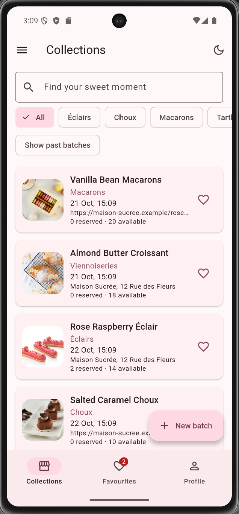
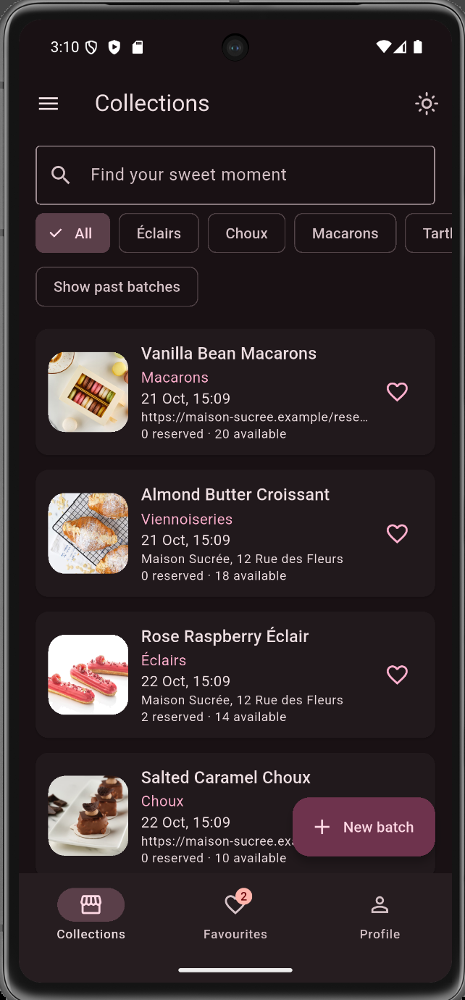
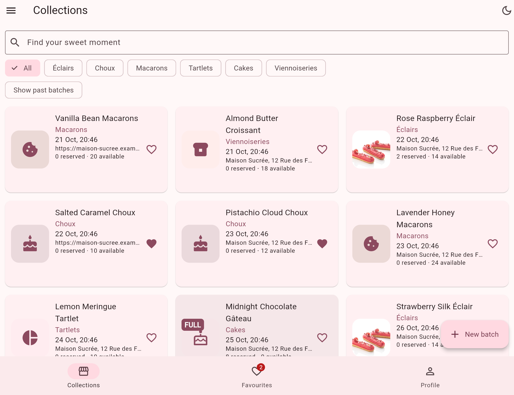

# Maison Sucrée — Fine Pâtisserie

A responsive Flutter application for exploring and reserving limited-edition pastry batches.

## Project Overview

Maison Sucrée is a boutique pâtisserie application developed as part of Flutter Laboratory 1. Users can browse pastry collections, search and filter available batches, add pastries to favourites, manage their profile, and reserve or cancel reservations.

The application demonstrates Flutter's Material 3 design, responsive layouts, state management, navigation, form validation, and Dart language features.

## Features

- Browse 12 sample pastry batches across six categories.
- Search pastries by title and filter by category or past batches.
- Switch between list and grid layouts depending on screen width.
- Add or remove pastries from favourites.
- View pastry details, descriptions, availability, and guest lists.
- Reserve or cancel a pastry reservation using the profile name.
- Create, edit, and delete pastry batches.
- Validate user input in forms.
- Confirm navigation when a form contains unsaved changes.
- Switch between light and dark themes.
- Reset sample data through the navigation drawer.

## Technology Stack

- **Framework:** Flutter
- **Language:** Dart
- **UI:** Material 3
- **State Management:** StatefulWidget and setState
- **Navigation:** Named routes and Navigator
- **Responsive Layout:** LayoutBuilder, ListView, and GridView
- **Data Storage:** In-memory sample data

No third-party packages are required for the application features.

## Screenshots

### Phone — Light Theme



### Phone — Dark Theme



### Tablet — Responsive Grid



## Architecture and Design Decisions

The application uses a StatefulWidget-based shell as the single source of truth for pastry collections and profile data. Child screens receive the required data and callback functions, keeping state updates centralized and predictable. The pastry creation and editing form returns a Pastry object through Navigator, allowing the shell to update its collection only after successful submission. LayoutBuilder switches between a vertical list on narrow screens and a multi-column grid on wider screens. PopScope protects users from accidentally losing unsaved form changes by displaying a confirmation dialog. Immutable data models and copyWith methods support controlled updates without directly modifying existing objects. Material 3 and ColorScheme.fromSeed provide consistent styling across light and dark themes. Future improvements could include persistent storage, API integration, authentication, and additional development tools introduced in later Flutter laboratories.

## Project Structure

```text
lib/
├── data/
│   └── seed_data.dart
├── models/
│   ├── countdown.dart
│   ├── pastry.dart
│   ├── pastry_category.dart
│   └── profile.dart
├── screens/
│   ├── collections_screen.dart
│   ├── detail_screen.dart
│   ├── favourites_screen.dart
│   ├── pastry_form_screen.dart
│   └── profile_screen.dart
├── utils/
│   └── format.dart
├── widgets/
│   ├── empty_state.dart
│   └── pastry_card.dart
├── main.dart
└── routes.dart
```

## How to Run

1. Install Flutter SDK and configure your development environment.
2. Clone the repository.
3. Navigate to the application directory:

```bash
cd laboratory1/maison_sucree
```

4. Install dependencies:

```bash
flutter pub get
```

5. Run the application:

```bash
flutter run
```

## Testing

Check the project with:

```bash
flutter analyze
flutter test
```

The application includes a widget test verifying that the main navigation screens are available.

## Author

Mereke Zhandarbek

Flutter Laboratory 1 — Maison Sucrée
